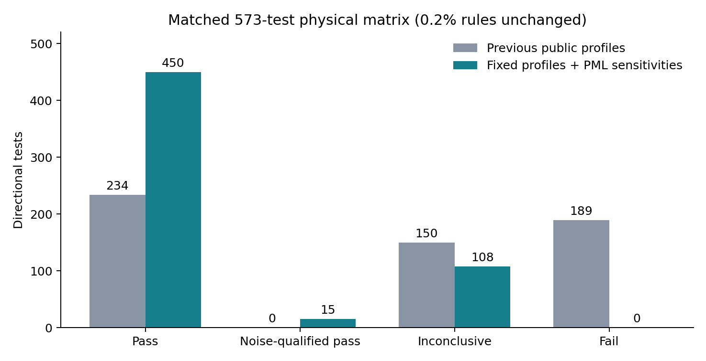
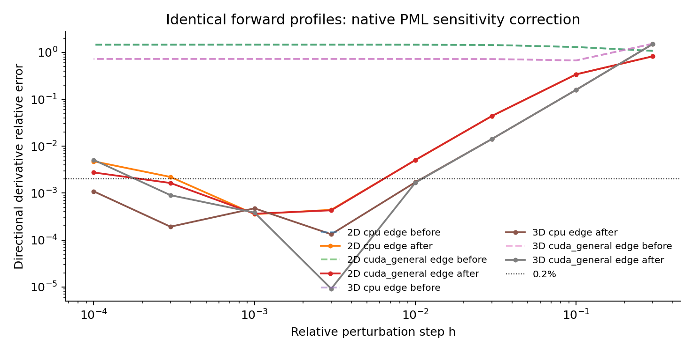

# DeepGPR：按 Deepwave 的 PML 材料延拓方式修复（2026-10-11）

审计执行时，本机同步远端 main 至 `386f214d88cae2111dda8c5aa1ef0434595b02f8`，保留本轮之前的 Yee/TV 修复、测试和审计证据。运行分支为 `test/gradient-verification`，当时修改尚未提交或推送；本报告与原始 JSON 保留该次验证环境。CPU/CUDA Linux 动态库已重建并安装到实际使用的 `src/DeepGPR/lib`。

**模型参数化现在是：更新整个输入物理模型；每次正演重新复制边界材料到 PML；PML 不作为独立优化参数。PML 中的材料敏感度会求和回对应的物理边缘、棱和角点。** 吸收配置使用固定参考速度，不再随当前边界材料变化。

与上次匹配的 573 个物理方向中，明确失败由 189 降为 0；本次为 **450 严格 PASS、15 噪声受限 PASS、108 INCONCLUSIVE**。15 项噪声受限结果不等同于达到 0.2% 的严格认证，108 项未定结果也不计为通过。长时间物理材料梯度的 NaN 已修复；任意初始场状态的超长时间反传仍存在外部 PML 角点 cotangent 溢出的已知数值限制，见第 5 节。

## 1. 同步与实现

同步前 HEAD 为 `3bfc1e9`，远端 main 多出四个提交，其中包含 PR #1 的 CUDA PTX fallback。先保存所有本地工作，再执行 fast-forward pull，最后恢复本地源代码修复。合并后的 `.github/workflows/workflow.yaml` 未被修改；用户合并的 PTX 改动保留。备份在 `/tmp/deepgpr-before-pull-20261011`，Git stash 也保留，具体记录见 [sync.json](sync.json)。没有覆盖上一次审计目录。

| 修改位置 | 最终行为 |
|---|---|
| `preprocessing/model_setup.py::_ExtendModel.backward` | 逐轴对复制区的梯度求和回边界，覆盖面、棱、角点及单元素维度；避免 CUDA scatter 原子累加 |
| `lib/deepgpr_cpu.c`、`lib/deepgpr.cu` | CPU、CUDA 普通和 INT8 材料梯度核保留整个演化 PML 的 ε/σ 敏感度；PEC/无效 tile lane 规则保留 |
| `solver/pml.py`、`solver/modeling.py` | 新增 keyword-only `pml_max_velocity`，默认 `299792458.0 m/s`；固定参考速度构造吸收系数，独立于当前 ε/μ |
| `solver/autograd.py`、`native/abi.py`、`lib/deepgpr.h` | 增加 `deepgpr_supports_pml_material_gradients` 能力标识；旧库不能静默执行错误的 PML 材料反传；ABI 6 函数签名不变 |
| Python/native 历史检查 | 有 PML 且需要材料梯度时拒绝 `wavefield_history_region="physical"`，因为缺失所需 PML 历史；forward-only、源/初态梯度、无 PML 材料梯度仍可使用 |
| 所有材料梯度核 | E_old 和有效 RHS 均严格为零时，局部材料敏感度严格为零，显式避免其与非有限 cotangent 相乘产生 NaN；非零敏感度不被裁剪或清零 |
| 测试、notebook、文档 | 公共有限差分包含模型最外圈，每次独立正演重新复制 PML；删除原先边界固定方向掩膜及过时说明 |

之前未提交的 Yee inactive-component/RHS 修复和 TV dtype 修复均保留。此次吸收参考速度改变了旧版按每个面的材料均值构造 profile 的数值函数，**不能宣称旧 public 波形逐位不变**。原生 E/H 更新方程、源接收器、CPML 正演递推和 history writer 未修改。

## 2. 与 Deepwave 的对应和使用方式

核查对象是官方 Deepwave v0.0.26，固定源码 commit `7dbaeda5fdfbff2a6d579dcc9f7f18488c5e6084`。其 PML 复制材料的敏感度会汇回模型边缘，官方文档说明这可能形成一格厚的大边缘梯度。这个梯度属于离散目标函数的真实敏感度；PML 不必独立优化。[官方边缘梯度说明](https://ausargeo.com/deepwave/example_large_edge_gradient)

Deepwave 原生 backward 不返回 profile 的导数，官方 scalar 梯度测试显式固定 `max_vel`。本次采用这一固定配置设计，而非把声学方程或数值常数复制到 Maxwell 求解器。Deepwave 自动 `max_vel=None` 的默认配置不能据此被认定为包含全部配置依赖的总导数。[固定速度的官方测试源码](https://github.com/ar4/deepwave/blob/7dbaeda5fdfbff2a6d579dcc9f7f18488c5e6084/tests/test_scalar.py#L52-L55)、[此前源码对照](../deepwave_comparison_20261011/Deepwave_PML_comparison.md)

默认调用即使用固定真空参考速度。若采用其他参考值，应根据预定的物性范围选定一次，并在优化迭代、FD 扰动和 checkpoint 各段保持一致。该值控制吸收 profile；实际物性的 CFL 检查仍照常执行。

完整模型梯度检查/高精度反演基线使用：

```python
pml_max_velocity = 299792458.0  # 优化循环外选定
# 在原 compute 调用的其他参数之外：
# mode=3  # 3D；mode=2 的精确材料梯度仅适用于 2D Ez-TM
# pml_max_velocity=pml_max_velocity
# wavefield_history_region="extended"
# model_gradient_sampling_interval=1
# wavefield_storage_dtype=torch.float32
```

只优化原始 `eps_r`、`sigma` 张量即可，包括其最外圈；不用新建 PML 参数。返回梯度形状仍等于原物理模型形状。时间采样、低精度或 INT8 历史属于梯度近似，不能视为所有模型上精确导数的保证。

## 3. 验证环境与主矩阵

Python 3.10.16，PyTorch 1.11.0+cu115，NumPy 1.26.4，Linux，RTX 4090，驱动 575.51.03，CUDA 构建工具 12.4，`OMP_NUM_THREADS=1`。传播为 float32，主要失配目标由接收波形作 float64 累加。全部数据为小规模合成输入，没有运行真实 GPR 数据或既有反演实验。

主矩阵保留上次相同的模型 A–G、空间/时间/PML/stencil 配置与 0.2% 多步长/Taylor/噪声判据。每个 J± 都是 `torch.no_grad()`、不保存材料历史的全新 native 正演，FD 不调用 backward，不冻结复制材料，不遮掉边界。新 profile 固定，观测也由相应新配置独立正演生成。3D 只计 CPU 和 CUDA general；此前初轮误重复标为 CUDA fast 的 3D 结果另存初始文件，不重复计数。

| 证据文件（data/） | 方向数 | 严格 PASS | 噪声受限 PASS | 未定 | FAIL |
|---|---:|---:|---:|---:|---:|
| basic_cpu.json | 79 | 67 | 3 | 9 | 0 |
| basic_cuda.json：fast/general | 158 | 134 | 6 | 18 | 0 |
| three_d_cpu.json | 72 | 43 | 4 | 25 | 0 |
| three_d_cuda.json：general | 72 | 45 | 2 | 25 | 0 |
| time_cpu.json | 47 | 38 | 0 | 9 | 0 |
| time_cuda.json | 47 | 40 | 0 | 7 | 0 |
| pml_cpu.json | 49 | 41 | 0 | 8 | 0 |
| pml_cuda.json | 49 | 42 | 0 | 7 | 0 |
| **总计** | **573** | **450** | **15** | **108** | **0** |

之前同 573 个方向为 PASS 234、FAIL 189、INCONCLUSIVE 150。当前各文件均核对了最终动态库 SHA256；汇总程序不接受不同库版本混计。[摘要 JSON](data/primary_summary.json)、[逐方向 CSV](data/primary_directions.csv)、[上次报告](../codex_audit_20261010/REPORT.md)



多数未定项涉及弱 σ 响应、像素方向、短记录或目标相消：有些 FD 值已经接近 AD，但缺少足够高于 float32 噪声的 Taylor 余项，仍保持未定。没有把最小误差的一个步长当作严格通过。

## 4. 相同正演配置下隔离修复效果

`native_before_after.py` 使用上次已修复 Yee 的旧库，搭配本次固定 profile 和 Python 延拓，再与最终新库比较。这是明确标注的诊断基线：只在旧库实验中绕过新增材料能力探针，生产入口仍拒绝旧库。该实验不代表旧 public 的材料相关 profile。

五个 2D/3D、CPU/CUDA 路径中，**接收波形及全部 30 个最终 E/H/CPML 状态逐位相同**。仅补齐材料敏感度和复制转置后，全部 15 个预设边缘/随机方向都通过原主判据。

| 配置 | 参数/方向 | 旧库最佳相对误差 | 新库扫描最佳相对误差 |
|---|---|---:|---:|
| 2D CUDA general，非对称 PML | ε / edge | 107.95% | 0.0364% |
| 同上 | σ / edge | 47.51% | 0.00566% |
| 同上 | joint / random | 12.11% | 0.00350% |
| 3D CUDA general | ε / edge | 67.51% | 0.000914% |
| 同上 | σ / edge | 49.84% | 0.0156% |
| 同上 | joint / random | 8.37% | 0.0719% |

表中的单点最佳误差只是摘要，判定使用完整多 h 曲线。最终 CPU/GPU ε 梯度的相对 L2 差别为 2D 约 2.8e-6、3D 约 8.6e-5；σ 为约 2.7e-6、3.4e-5；波形差别约 3.7e-7、5.3e-7。[完整对照数据](data/native_before_after_all.json)



## 5. 专项、回归与已知限制

- 新增完整模型专项共 180 个方向：CPU 72、CUDA fast/general 108，覆盖 ε、σ、joint 的 edge/random/smooth、2D/3D、stored/reconstructed history，以及非零 E/H/24 CPML 初态的单步材料导数。**178 严格通过、2 未定**；全部 J±、方向和步长保留在 [focused_all_final.json](data/focused_all_final.json)。两条 CPU random/joint 的 ε、σ 响应几乎相消，24 组对称一 ULP 纯正演测得目标噪声约 5.4e-7，无法解析 0.2% 阈值，未计为通过。CUDA 的弱 3D σ 方向通过增加物理合法大步长得到相邻 h=2/1 的 0.025%/0.081% 一致性；没有更换方向或放宽容差。初轮 5h/8h 原始失败文件保留。
- 8 组 CPU/CUDA、2D/3D、stored/reconstructed、reentrant/nonreentrant checkpoint：接收波形、全部 30 终态逐位相同，梯度匹配，全物理边缘 joint FD 均严格通过。[checkpoint 证据](data/focused_all_final_checkpoint.json)
- 60 组 GPU 历史格式/转换后端/卸载配置，360 个面、角点、全模型方向：298 通过、62 未定、0 明确失败。覆盖 FP32、FP16/BF16 legacy/native_scalar/native_vec2、INT8、stored/reconstructed 和异步 pinned CPU 卸载；不支持的 INT8 异步 CPU offload 明确拒绝。这些是所测方向的结果，不意味着有损历史得到全张量精确梯度。[压缩审计](cuda_storage_edge_audit.md)、[全部原始记录](data/cuda_storage_edge.json)
- 完整 unittest discovery：CPU 176 项无失败，45 skips（CUDA/多 GPU 不可用及两条数值未定）；GPU 176 项无失败，3 skips（多 GPU 不可用及两条数值未定）。旧 CUDA Taylor fixture 改用 float64 目标累加并扩展小 h，原 1.5% 判据保留；其弱方向不纳入 0.2% 主矩阵通过数。最终长时间 CPU 回归进一步要求 ε、σ 两个梯度均有限。[CPU 日志](logs/full_cpu_regression.log)、[GPU 日志](logs/full_cuda_regression.log)
- 02/03/04 notebook 的原始代码单元按顺序在本机 Python 环境执行，全部通过；依赖没有 nbclient，因此不声称进行了 notebook kernel 执行。带执行结果的副本与图在 [notebooks/](notebooks/)，结果见 [notebook_execution.json](data/notebook_execution.json)。CPML 厚度 6/10/14 的晚时 RMS 相对无 PML 为约 4.04e-4、1.77e-4、1.77e-4，因果早时波形检查也通过。

**长时间零损耗边界的实际问题和限制：** 原 1500 步 3D 回归正演/history 全部有限，但外侧 PML 角点的原始状态 cotangent 会溢出。隔离 CPU 原生插桩测到 16031 次非有限 cotangent，全部对应 `E_old=0` 且 `RHS=0`，非零局部材料敏感度的计数为 0。原来直接乘出 NaN，复制求和后污染 7 个物理角点。当前三种材料累积核显式保留这些严格零贡献，而不是裁剪非零梯度、缩短记录或遮掉物理边缘。

最终 nt=1500、σ=0、interval=1/10 的 CPU/GPU 物理材料梯度均有限；interval=1 的全边缘 ε 方向相邻多 h 误差小于 0.2%。一个单角点导数约 6.7e-9，独立 FD 在 float32 分辨率下未定，未强行计为通过。interval=10 与完整历史梯度的相对 L2 差别约 8.4e-5，只代表这个 fixture；interval=10 已超源频谱推荐界限，仍是近似。[CPU 长时证据](data/long_time_cpu.json)、[GPU 长时证据](data/long_time_cuda.json)

插桩源码和测量配置保存在 [diagnostics/zero_sensitivity_probe_cpu.c](diagnostics/zero_sensitivity_probe_cpu.c) 与 [diagnostics/zero_sensitivity_probe.json](diagnostics/zero_sensitivity_probe.json)。它是修复零乘积前的隔离诊断库源码，不作为生产库使用。

**原始外侧 PML 初始状态 cotangent 的溢出没有被消除。** 若要优化任意初始 E/H/CPML 状态并运行这种长时间零损耗配置，不能据本次材料检查认为该状态梯度也稳定。本轮未重复之前全部网络 fixture/损失专项，没有将它们计入此次通过数。本次亦没有进行跨平台或其他 GPU 的运行验证。

## 6. 构建、复现与证据

最终 ABI 6 的 Linux CPU/CUDA 库均导出新能力探针。CUDA 包含 sm_50/52/60/61/70/75/80/86/89/90 的 SASS 和 compute_90 PTX；未启用 fast-math。PTX/SASS 的存在经过 `cuobjdump` 检查；实际运行验证硬件仅是 RTX 4090。Windows/macOS 随仓库分发的旧库在本机未重建，PML 材料梯度会明确要求重建。[构建/源码/库哈希](native_build_manifest.json)、[PTX 记录](logs/cuda_ptx.txt)、[SASS 记录](logs/cuda_sass.txt)

每个主矩阵 JSON 的 environment 保存实际命令、commit、分支、设备和源码/库哈希。Python 为 `/home/ll/anaconda3/envs/deepgpr/bin/python`，使用 `OMP_NUM_THREADS=1`。关键脚本：

```sh
python tests/gradient_verification/deepwave_pml_fix_20261011/physical_verification.py basic --paths cpu,cuda_fast,cuda_general
python tests/gradient_verification/deepwave_pml_fix_20261011/physical_verification.py 3d --paths cpu,cuda_general
python tests/gradient_verification/deepwave_pml_fix_20261011/physical_verification.py time --paths cpu --tag cpu
python tests/gradient_verification/deepwave_pml_fix_20261011/physical_verification.py time --paths cuda_fast --tag cuda
python tests/gradient_verification/deepwave_pml_fix_20261011/physical_verification.py pml --paths cpu --tag cpu
python tests/gradient_verification/deepwave_pml_fix_20261011/physical_verification.py pml --paths cuda_fast --tag cuda
python tests/gradient_verification/deepwave_pml_fix_20261011/native_before_after.py
python tests/gradient_verification/deepwave_pml_fix_20261011/long_time_probe.py --device cpu
python tests/gradient_verification/deepwave_pml_fix_20261011/long_time_probe.py --device cuda
python tests/gradient_verification/deepwave_pml_fix_20261011/cuda_storage_edge_audit.py
python -m unittest discover -s tests -p 'test_*.py' -v
python tests/gradient_verification/deepwave_pml_fix_20261011/summarize.py
```

实际分别运行 CPU/GPU 的 basic/3d 以便独立记录；复现时按 JSON 命令使用相同 `--tag` 即可。保存 focused 原始数据可设置 `DEEPGPR_PML_FD_RESULTS`。本轮已通过 CI 同样范围的 Ruff `src/DeepGPR tools`、修改的测试/notebook 生成器 Ruff，以及 `git diff --check`。
